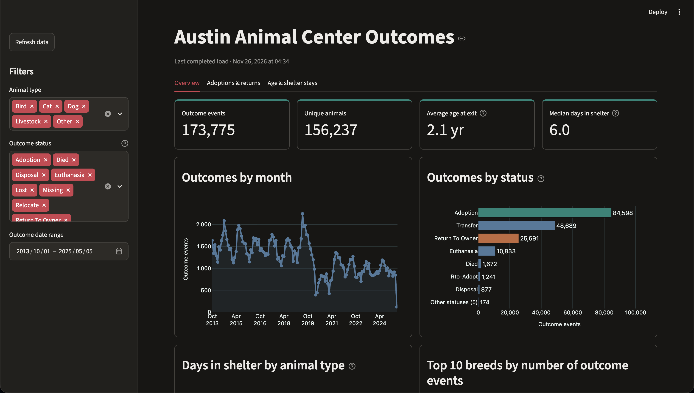
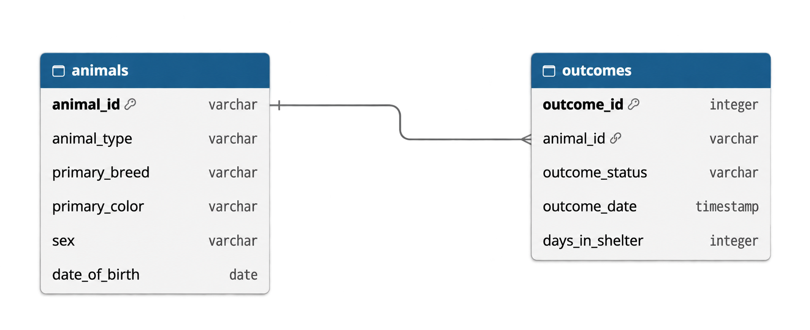
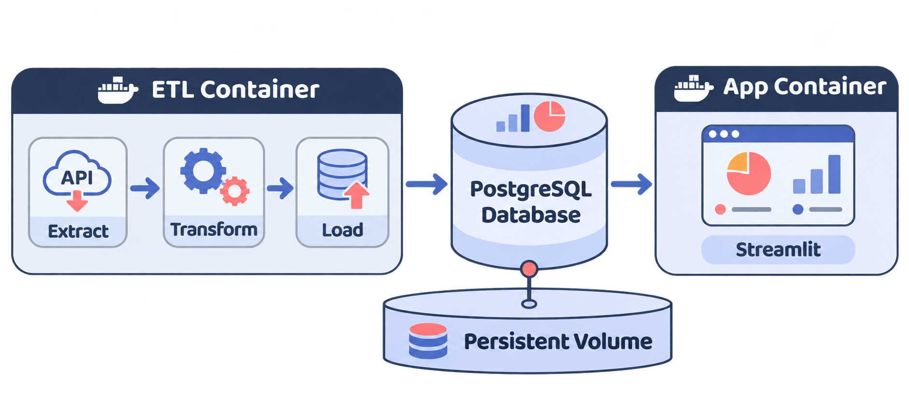

# DAEN 328 Term Project 2026
*Ruhi Ashley, Ryan Dobbelaere, Thomas Koch, Kaden Schwertner*

## Overview

This repository is a complete ETL data pipeline, from extraction to data visualization in a streamlit dashboard. The data source is the [Austin Animal Center Outcomes (10/01/2013 to 05/05/2025)](https://data.austintexas.gov/Health-and-Community-Services/Austin-Animal-Center-Outcomes-10-01-2013-to-05-05-/9t4d-g238/about_data) consisting of ~174k rows and 12 columns.

*Note: The app uses a second, sister dataset: [Austin Animal Center Intakes (10/01/2013 to 05/05/2025)](https://data.austintexas.gov/Health-and-Community-Services/Austin-Animal-Center-Intakes-10-01-2013-to-05-05-2/wter-evkm/about_data) to create more insightful analytics in the dashboard*

## Instructions to run 

Clone the repo onto your machine and navigate to the folder:

  ```bash
  git clone <repository-url>
  cd <repository-directory>
  ```
  If you want to open the project in vscode run:
  ```bash
  code .
  ```

Next create your .env file:
  ```bash
  cp .env.sample .env
  ```

Replace **INSERT_STRONG_PASSWORD** with a strong password.

Build and start the services using:
  ```bash
  docker compose up --build
  ```

Open the dashboard at `localhost:8501`. The postgres database is accessible at `localhost:5433`.

To stop the services, press `CTRL+C` and run:
  ```bash
  docker compose down
  ```

## The dashboard



*The homepage of the dashboard*


## Extraction and incremental pulls

We pull Austin Animal Center’s historical data in pages of 1,000 records, check page sizes and repeated IDs, and save the results as JSON. If a request fails temporarily, we allow up to 3 attempts with 5-second waits.

On reruns, we read the latest saved outcome date from outcomes.json and pull records starting 30 days before that date to catch updates. We merge by record ID to add new records and update existing records when their values change.

## Database schema



We split the cleaned data into two related tables so no animal's information is repeated. The animals table has one row per animal, with animal_id as the primary key. The outcomes table has one row for each time an animal left the shelter, with outcome_id as the primary key and animal_id as a foreign key back to animals. A third table, etl_state, stores the latest outcome date loaded and when the pipeline last ran. The pipeline creates all three tables itself, and database credentials are read from .env.

Each run upserts with "INSERT ... ON CONFLICT ... DO UPDATE" on each table's primary key. New records are inserted, existing records are updated only when their values change, and unchanged records are skipped. Animals are loaded before outcomes so every outcome points to an existing animal, and the whole load runs as one transaction. The first run inserted 156,237 animals and 173,775 outcomes. The second run inserted and updated 0 rows, so there were no duplicates.

## Containerization with docker



| Service | Explanation | Address |
|---|---|---|
| `etl` | Extracts, transforms, and loads data | Runs as a Docker service; no browser address |
| `db` | PostgreSQL database | `localhost:5433` from the host; `db:5432` from other containers |
| `app` | Streamlit dashboard | `http://localhost:8501` |


## Contributions

### **Ruhi Ashley**

Worked on extraction, including pulling data from Austin’s API, pagination, incremental pulls, merging records by ID, checking for duplicates, handling failed requests, and saving raw data for cleaning.

### **Ryan Dobbelaere**

Worked on dockerization, creating the app, and the readme. Created a 3 container system for the app, pictured above in the *Containerization with docker* section. Worked on general bug fixes as needed, and provided all final touches for the project.

### **Thomas Koch**

Worked on transformation, creating a modular design as well as tests to prove accuracy. Ensured the transform would produce an output that was usable by the load script. Worked to create helpful visualizations on the streamlit dashboard.

### **Kaden Schwertner**

Worked on loading, including designing the normalized database schema, creating the tables and keys, loading the cleaned data into PostgreSQL, preventing duplicate rows on reruns, and saving the pipeline's progress in the database. Created the slideshow presentation.

*Note: each member made their own slides for the slideshow*

